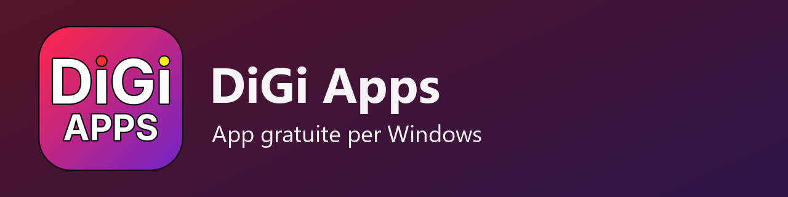
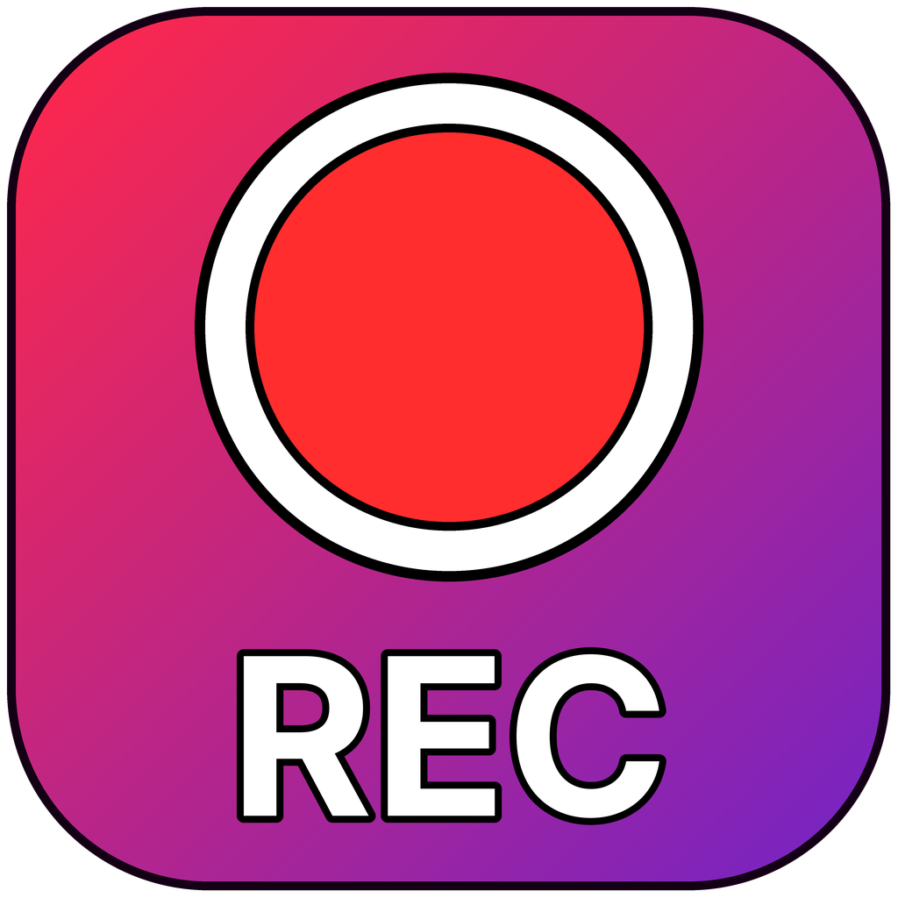
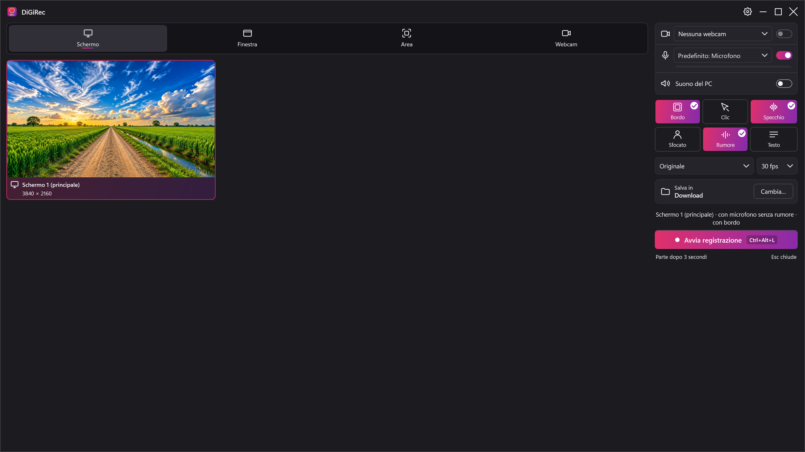
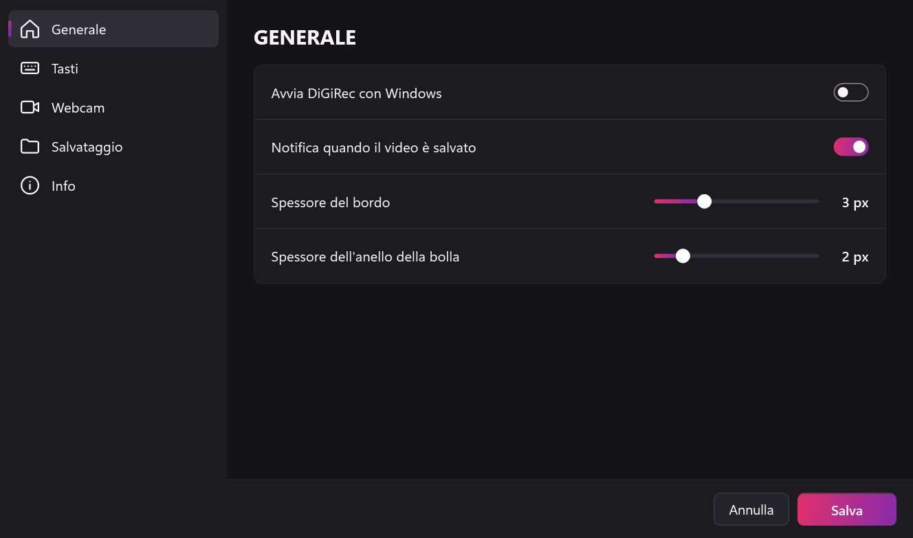
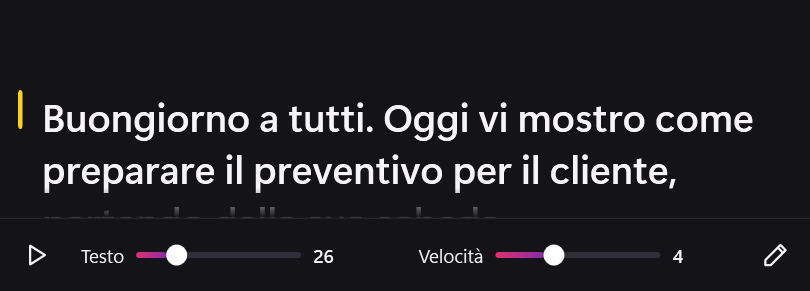
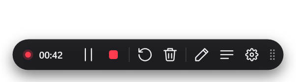
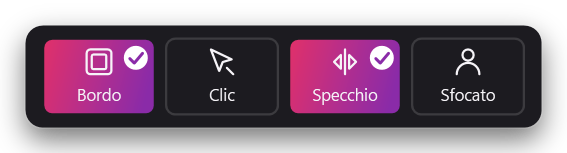

  

  

# DiGiRec

## 🎥 Registra lo schermo e la webcam su Windows, senza cloud e senza account

### ⬇️ [Scarica DiGiRec](https://github.com/DiGi-Apps-Dev/DiGiRec/releases/latest)

I video restano sul tuo PC, in MP4. DiGiRec fa parte di **DiGi Apps**, app gratuite per Windows.

### Cosa fa

- **Cosa registrare:** lo schermo intero, una finestra, un'area che disegni tu, oppure solo la webcam.
- **Webcam a bolla:** la tua faccia in un cerchio sopra lo schermo, da spostare e ingrandire, con lo **sfondo sfocato** e le regolazioni dell'immagine (luminosità, contrasto, esposizione…).
- **Voce pulita:** riduzione del rumore (ventola, tastiera, traffico), volume della voce regolato da solo e niente gracchiare. Il microfono segue quello predefinito di Windows, anche se colleghi le cuffie con il programma già aperto.
- **Suono del PC** insieme alla voce, se vuoi.
- **Durante la registrazione:** pausa, riprendi, ricomincia o annulla; i **clic** si vedono con un'onda gialla; puoi **disegnare** sullo schermo a mano libera in cinque colori; un **teleprompter** fa scorrere il tuo testo, visibile solo a te e non nel video.
- **Alla fine:** anteprima del video, **taglio** dell'inizio e della fine, salvataggio in MP4 nella cartella che scegli.
- **Se il PC si spegne** a metà registrazione, alla riapertura DiGiRec ti propone di recuperare il video.

## Come si vede

  

| | |
|---|---|
|  |  |

| | |
|---|---|
|  |  |

## Installazione

Scarica `DiGiRec-Setup-<versione>.exe` dalla pagina **Releases** e aprilo con un doppio clic.
L'installatore contiene già tutto quello che serve, anche il componente .NET di Microsoft: non scarica niente da internet e non chiede la password di amministratore.

### Avviso di Windows: «Windows ha protetto il PC»

L'installatore non ha la firma digitale, quindi la prima volta Windows mostra una finestra blu.

1. Clicca su **Ulteriori informazioni** (è una scritta sotto il testo, non un pulsante grande).
2. Compare il pulsante **Esegui comunque**: cliccalo.

### L'antivirus dice che il file è sconosciuto

Alcuni antivirus avvisano con file nuovi e non firmati anche se sono sani. Scegli «Consenti» o «Aggiungi un'eccezione» (i nomi cambiano da antivirus ad antivirus). Se invece l'antivirus indica il nome preciso di un virus, non andare avanti.

## Tasti rapidi

| Tasti | Cosa fanno |
|---|---|
| Ctrl+Alt+L | apri DiGiRec / ferma la registrazione |
| Ctrl+Alt+P | pausa e ripresa |
| Ctrl+Alt+N | ricomincia da capo |
| Ctrl+Alt+X | annulla la registrazione |
| Ctrl+Alt+D | disegno sullo schermo |
| Ctrl+Alt+T | teleprompter |

Si cambiano in Impostazioni › Tasti.

## Requisiti

- Windows 10 versione 2004 o più recente, oppure Windows 11, a 64 bit.
- Una webcam e un microfono, se li vuoi usare.
- La scheda video non è obbligatoria: se c'è, lo sfondo sfocato la usa ed è più preciso.

## Disinstallare

Impostazioni di Windows › App › App installate › DiGiRec. Le tue impostazioni e i video restano.

## Licenza

DiGiRec è gratuito, con licenza **MIT** (vedi [LICENSE](LICENSE)). Usa componenti di terze parti con le loro licenze (NAudio, Vortice.Windows, ONNX Runtime, DirectML, MediaPipe, MODNet, GTCRN): l'elenco completo è nel file `THIRD-PARTY-NOTICES.md` installato insieme al programma.
